# TP Spring Security JWT

Projet Spring Boot de démonstration d’une authentification **JWT** avec **Spring Security**, **JPA** et **H2**.

## Objectif

- créer un utilisateur en base
- connecter un utilisateur
- générer un token JWT à la connexion
- protéger les routes avec un filtre JWT

## Architecture

```
org.example.security
├── config
│   └── SecurityConfig
├── controller
│   ├── AuthController
│   └── UserController
├── dto
│   ├── AuthResponse
│   ├── LoginRequest
│   └── RegisterRequest
├── entity
│   └── AppUser
├── repository
│   └── UserRepository
├── security
│   ├── JwtFilter
│   └── JwtService
└── service
    └── CustomUserDetailsService
```

## Captures du compte rendu PDF

### Figure 1 — Arborescence du projet et séparation des différentes couches

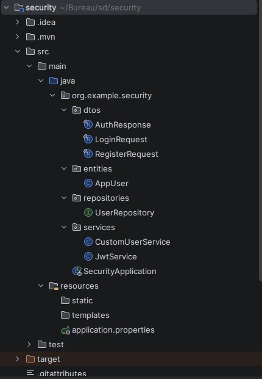

### Figure 2 — Paramètres de la base H2, de JPA et du mécanisme JWT

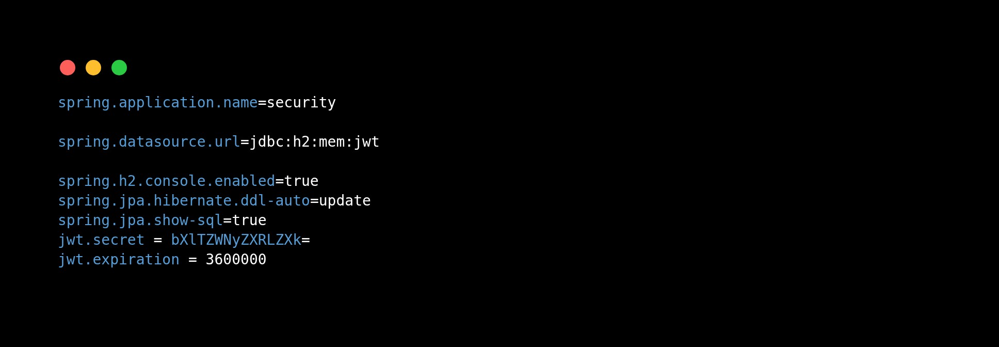

### Figure 3 — DTO de réponse contenant le JWT généré

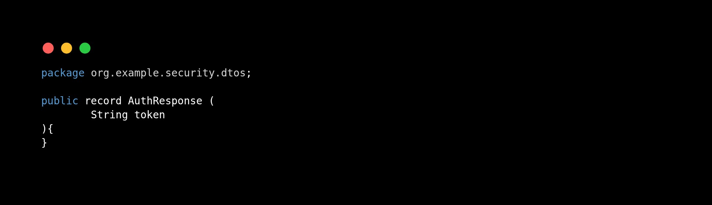

### Figure 4 — DTO utilisé pour recevoir les identifiants de connexion

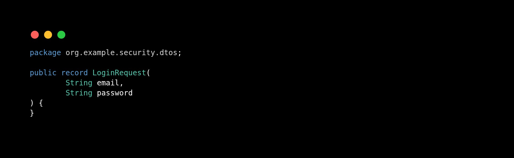

### Figure 5 — DTO de création d’un nouvel utilisateur

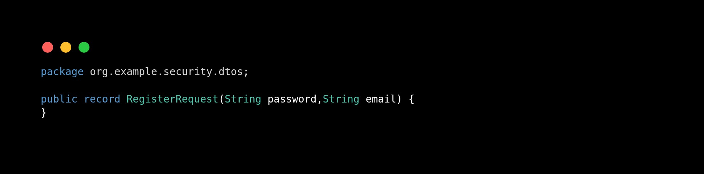

### Figure 6 — Entité JPA `AppUser` et définition des champs persistés

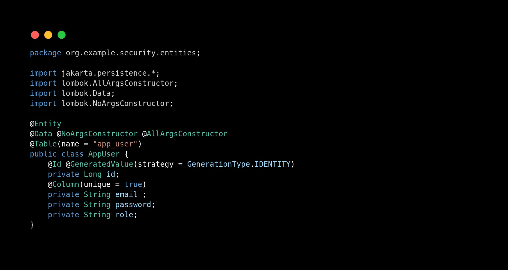

### Figure 7 — Repository Spring Data JPA dédié aux utilisateurs

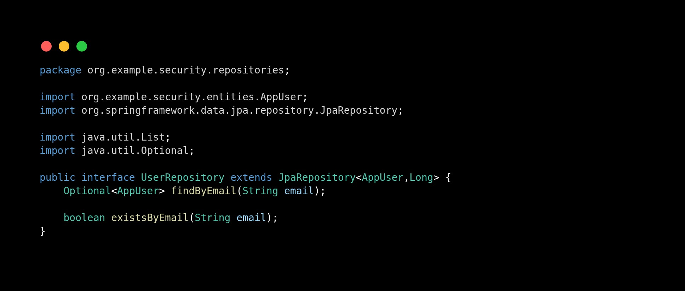

### Figure 8 — Service de chargement des utilisateurs compatible avec Spring Security

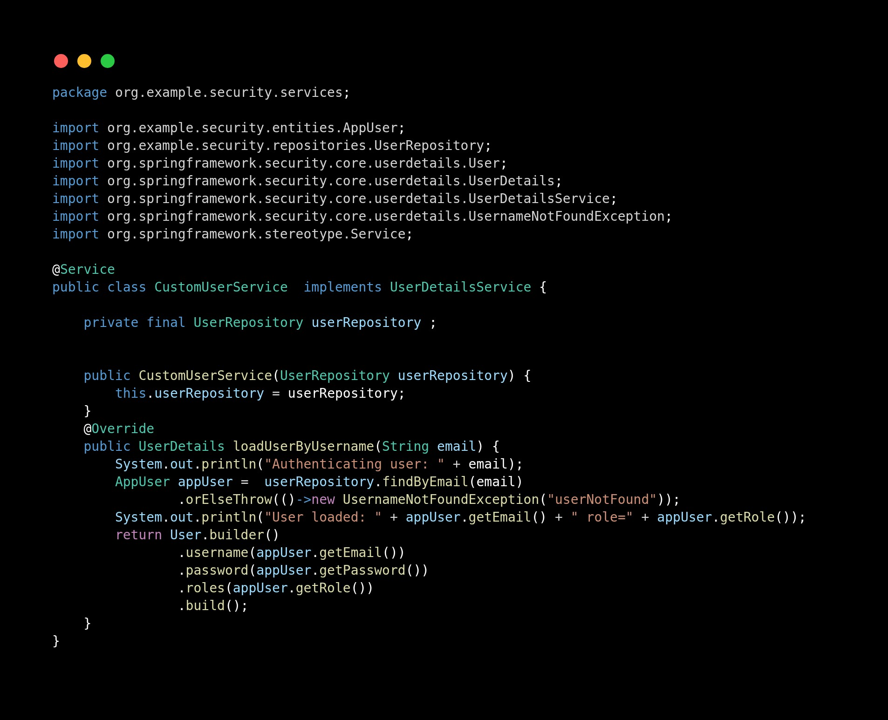

### Figure 9 — Service JWT : génération, lecture des claims, contrôle d’expiration et validation

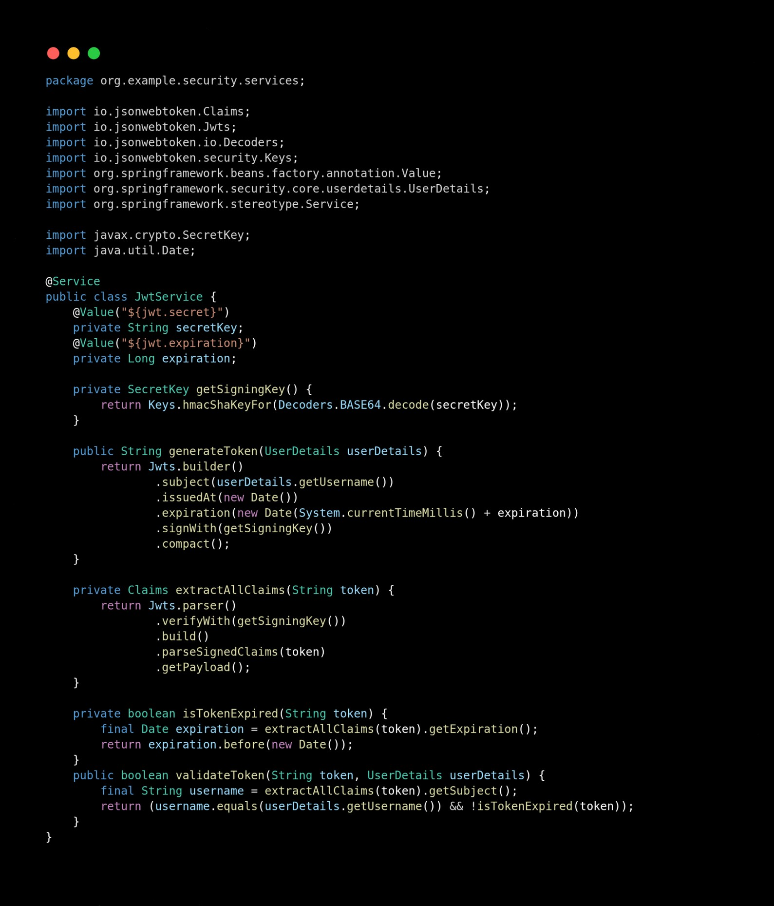

### Figure 10 — Classe de démarrage de l’application Spring Boot

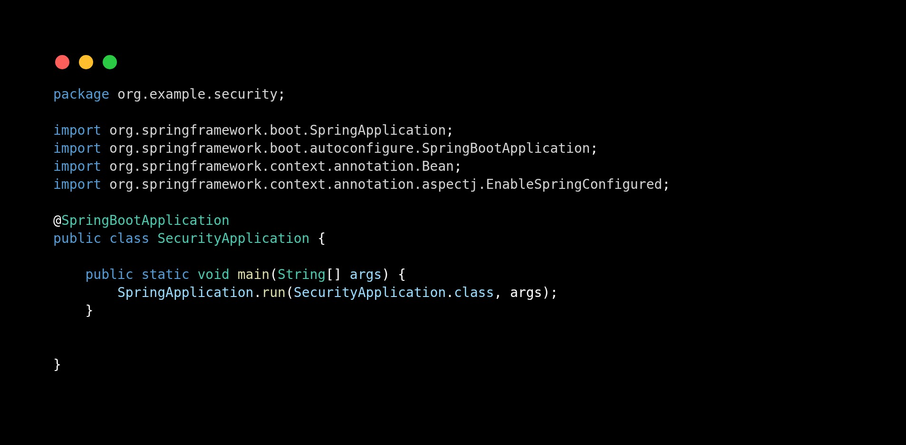

## Configuration

Le projet utilise :

- une base **H2 en mémoire**
- **JPA/Hibernate** pour la persistance
- **BCryptPasswordEncoder** pour chiffrer les mots de passe
- une authentification **stateless**

## Endpoints

### Authentification

- `POST /auth/register`
- `POST /auth/login`

### Routes protégées

- `GET /api/hello`
- `GET /api/profile`

## Flux de sécurité

1. l’utilisateur s’inscrit via `/auth/register`
2. l’utilisateur se connecte via `/auth/login`
3. le serveur renvoie un **JWT**
4. le token est envoyé dans le header `Authorization: Bearer <token>`
5. `JwtFilter` lit le token et alimente le `SecurityContext`

## Tests Postman

### 1. Login et génération du token

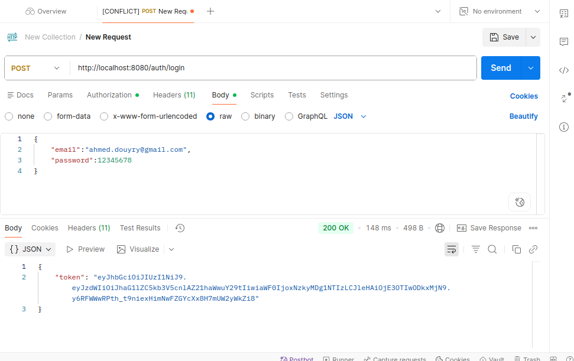

### 2. Accès à `/api/hello` avec Bearer Token

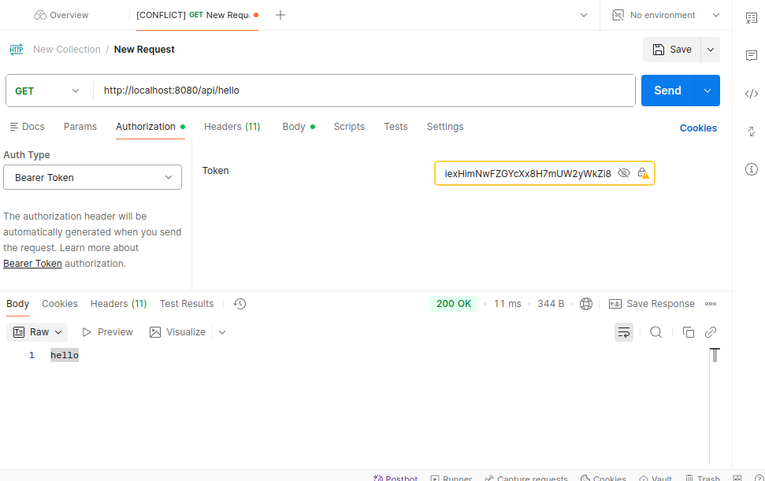

### 3. Accès à `/api/profile` avec Bearer Token

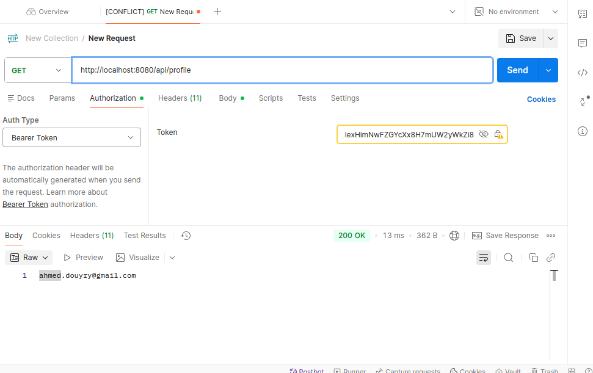

## Notes

- Le rôle attribué lors de l’inscription est `USER`.
- La clé JWT doit être suffisamment longue pour éviter `WeakKeyException`.
- La durée de validité du token est définie dans `application.properties`.
